# 🍽️ Food&Co — A social network for people who live to eat

🌐 **English** · [Español](README_es.md)

A full product: a **mobile app** (iOS & Android) where people post dishes, review restaurants and share recipes; a **web admin dashboard** to moderate content, manage restaurants and monitor storage; and a **bilingual landing page** that also serves the app's public share pages. Designed and built by Infinity, end to end.

  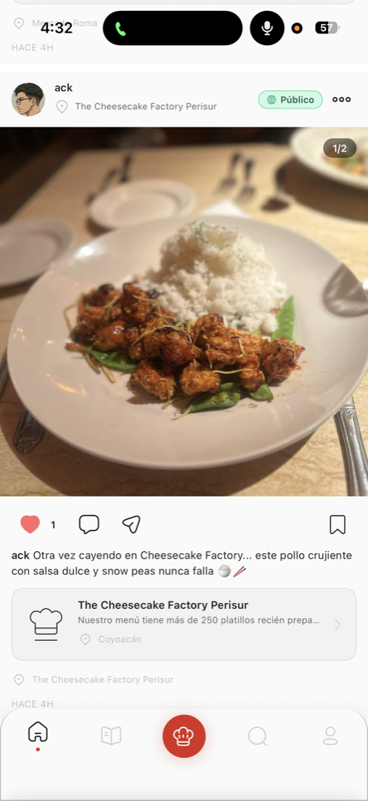
  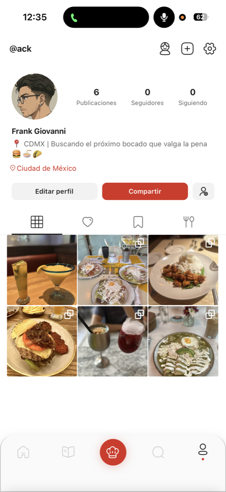
  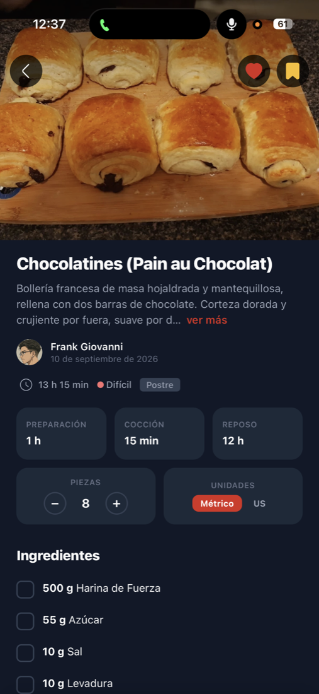

---

## 🎯 About the project

Review apps feel cold: loose ratings and little community. The goal was to make discovering where to eat feel **social, close and visual**, and let restaurants become known through the people who visit them. A social app also grows fast — thousands of photos, users, reports and storage costs — so the team needed one place to **see, moderate and decide**.

> **Role:** designed and developed the app, dashboard and landing end to end.

| Part | What it is |
|---|---|
| 📱 **Mobile app** | iOS + Android from a single codebase |
| 🖥️ **Admin dashboard** | Web panel for moderation, restaurants, support and storage analytics |
| 🌐 **Landing page** | Bilingual site, legal pages, deep links and public share pages |

## 📱 Mobile app

**Stack:** Expo SDK 54 (new architecture) · React Native 0.81 · React 19 · Expo Router · NativeWind v4 · Zustand · TanStack Query · Reanimated 4 · Skia · FlashList · Gorhom Bottom Sheet · react-native-maps · socket.io-client · i18next · Sentry · EAS

- **Discover:** feed with photo carousels, description and a **restaurant card** (name, place type, area) linking straight to the venue; nearby restaurants and an interactive map.
- **Share:** pick several photos, crop, apply filters, rotate or flip and publish, without leaving the app.
- **Connect:** profile with gallery, followers and tabs for posts, likes, saved and places; likes, comments, saves and lists; push notifications.
- **Cook:** community recipes with checklist ingredients, prep/cook/rest times, adjustable servings and a metric/US unit switch.
- **Accessible:** adjustable text size (S/M/L/XL), high contrast and reduced motion, persisted per user. Dark mode.
- **Auth:** email, Google and Apple sign-in, tokens in secure storage.

  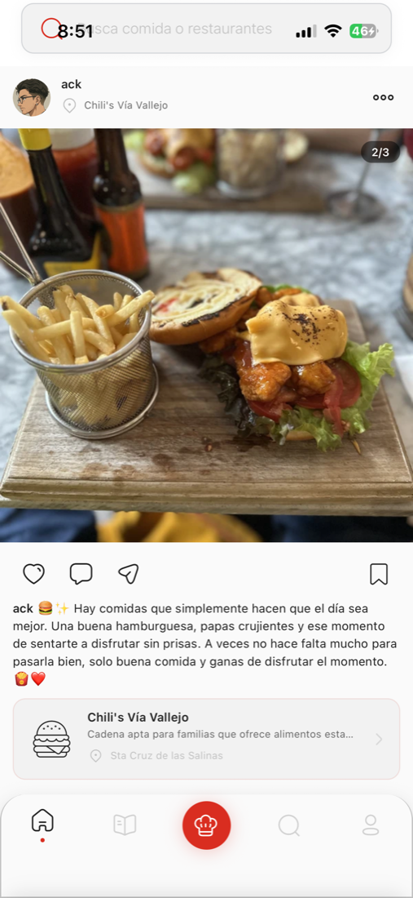
  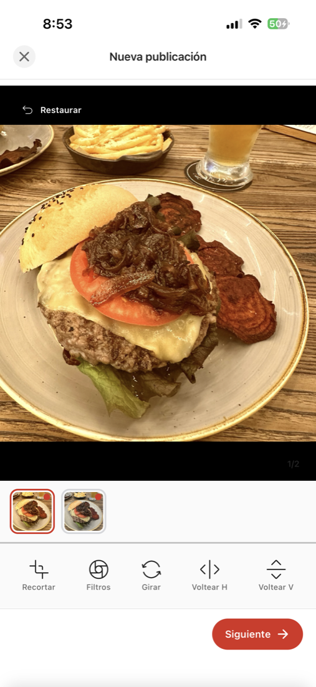
  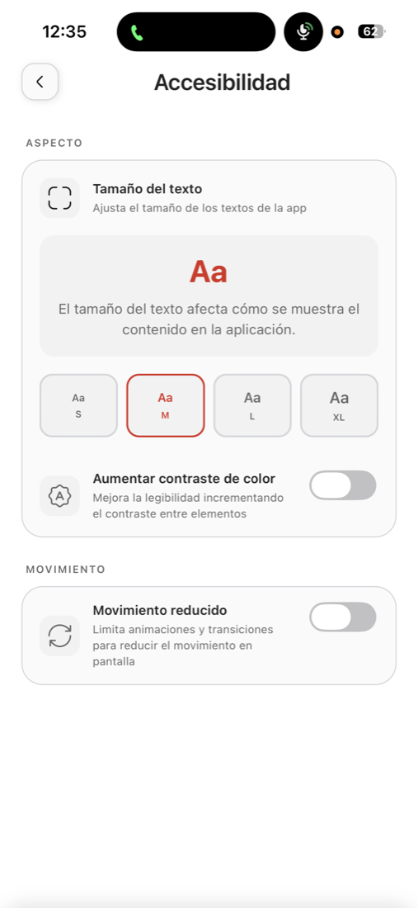

> Screenshots use my own personal account.

### Decisions
- **Route groups by access** (`(auth)`, `(root)`, `(info)`): route guards live in a single `_layout` per group instead of being repeated in every screen.
- **Zustand for auth/UI state + TanStack Query for server data.**
- **Own design system** with NativeWind and dark mode; FlashList and `expo-image` for long image-heavy lists; Reanimated for animations.
- **HEIC photos from iPhone:** processed on the client with `expo-image-manipulator`, converted to WebP on the server (`sharp` + `heic-convert`).
- **Graceful fallback** when the Android Google Maps API key is missing, instead of crashing.
- Maps, push and social-login setup documented with written guides for the client.

## 🖥️ Admin dashboard

**Stack:** Astro 6 (SSR on Cloudflare) · React 18 · Tailwind CSS 4 · ApexCharts · FullCalendar · Leaflet · jVectorMap · Flatpickr · Framer Motion · auth middleware

Modules: analytics, users (+ statistics), administrators, posts, recipes, restaurants (+ statistics), **import from Google Places**, support tickets and file/storage services. Global search, collapsible sidebar, light/dark mode.

### Case: R2 Analytics
**Problem:** no visibility into the growth or cost of image storage. **Solution:** a backend module that queries Cloudflare's analytics API and a panel with storage/object trend, success vs. error rate, daily uploads, operations by action and a 7/14/30-day range selector.

  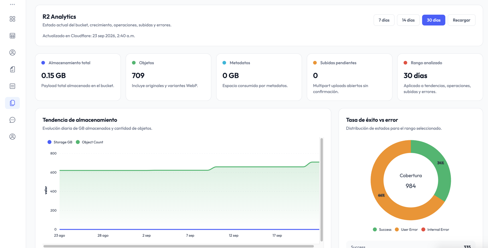
  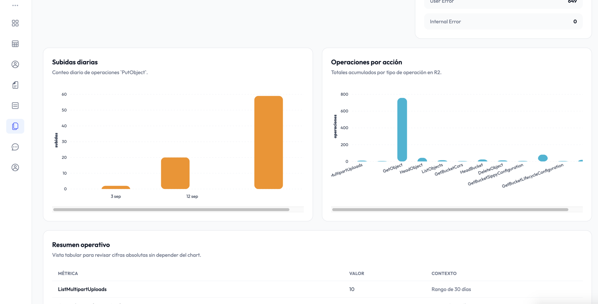

### Case: import restaurants from Google
Capturing every restaurant by hand is slow, so I built an import flow with Google Places: pick the search centre on a map, density/radius, place types, with a cost estimate before running.

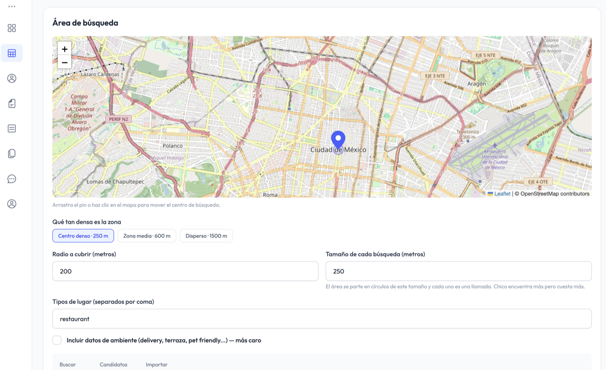

## 🌐 Landing page

**Stack:** Astro 6 · React 19 · Tailwind CSS 4 (`@tailwindcss/vite`) · Cloudflare (`@astrojs/cloudflare`) · custom i18n

Bilingual (ES/EN), responsive, light/dark, with one module per section (Nav, Hero, Features, HowItWorks, SocialFeed, Categories, Stats, DownloadCTA, HelpCenter, Footer).

- **Shareable links:** every post, restaurant, recipe and profile has a public page (`/post/[id]`, `/restaurant/[id]`, `/recipe/[slug]`, `/u/[username]`) that invites people to open the app.
- **Universal links** for iOS and Android (`apple-app-site-association` and `assetlinks.json` generated as Astro routes).
- **Legal & store compliance:** terms, privacy, community guidelines, notice, content policy, a help centre and an **account-deletion page** (an app-store requirement), all in two languages.

  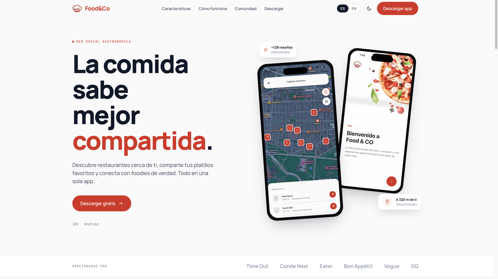
  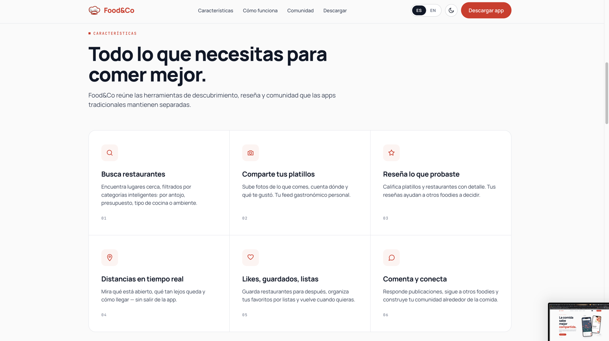

  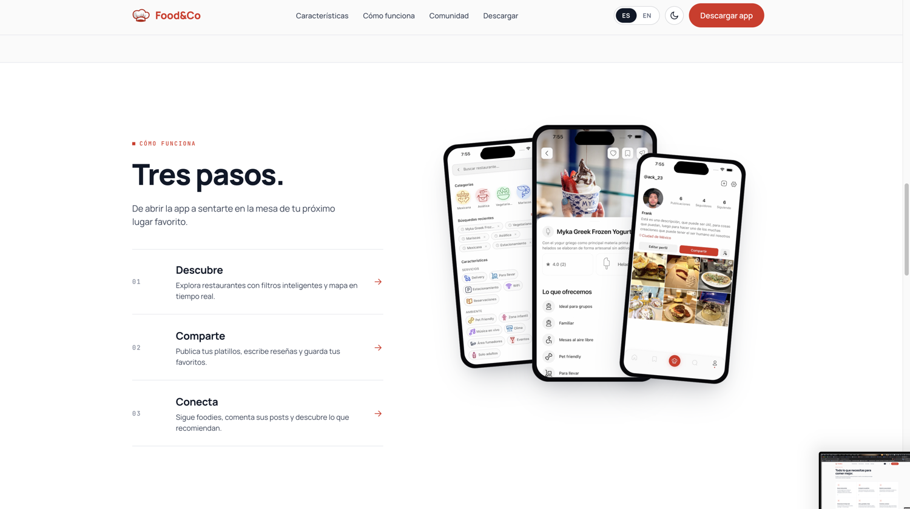
  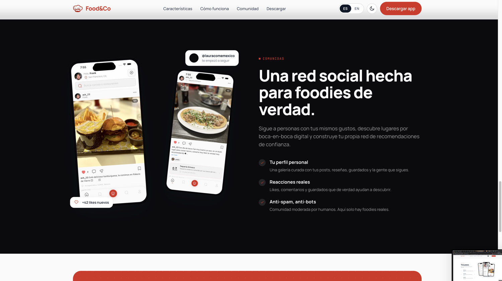

> Figures on the landing (e.g. "+128 reviews") and the "mentioned by" logos are mock-ups, not real results.

## 🌱 Honest notes

- The mobile project doesn't have automated tests yet.
- The Android build needs a Google Maps API key.

## 📄 Note

This repository contains **documentation only**; the source code is private. Happy to walk through it in an interview.

## 📬 Contact

**Infinity dev por Frank** · [GitHub](https://github.com/TheGeistGamer) · [Infinity](https://infinitydev.agency)
